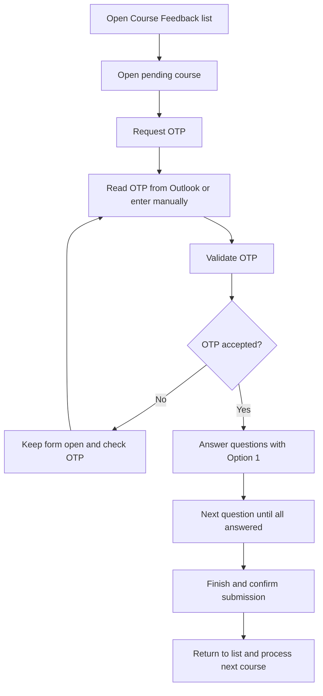
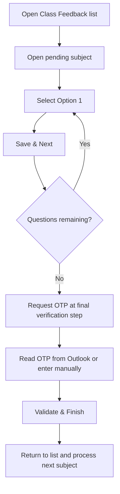

# AutoFeed - Amrita Feedback

**Two feedback flows. One Chrome extension.**

Automates pending feedback on `students.amrita.edu`, selects **Option 1**, retrieves a verification OTP from an open Outlook tab, and advances through pending subjects.

> **Before starting:** This tool submits real feedback and accepts confirmation dialogs automatically. It does not write personalized answers: it selects Option 1. Use only for your own account, when these answers reflect your views and institutional rules allow automation. Submitted feedback may not be editable.

## Understand the two flows

### Course feedback — OTP comes FIRST



**Order:** Request OTP → verify OTP → answer all questions → Finish → confirm submission → next course.

OTP verification is not feedback submission. The extension must reach the questions after verification before completing the course flow. Question count follows the portal rather than a fixed course-question count.

### TPA / class feedback — questions come FIRST

The class-feedback route and existing code call this **Class TLP**. If your portal labels this TPA, choose the class-feedback page below; no separate TPA-specific route is defined in this project.



The existing class flow targets 15 questions followed by the final OTP step. Portal changes may require selector updates.

## Install the Chrome extension

1. Extract this project if downloaded as a ZIP. The folder you select must directly contain `manifest.json`.
2. Open `chrome://extensions` in Chrome.
3. Enable **Developer mode**.
4. Click **Load unpacked**.
5. Select `Amrita-Feedback-Automation` itself, containing `manifest.json`, `amrita.js`, `background.js`, `outlook.js`, `widget.css`, and the `icons` folder. Do not select an outer folder, a ZIP file, or an individual file.
6. Refresh any Amrita and Outlook tabs already open.

If Chrome reports **“File path cannot be resolved”** or **“Could not load manifest”**, cancel the dialog and select the folder that shows `manifest.json` immediately inside it. The manifest is not inside a second nested project folder.

No Python installation is needed for the extension.

## Run feedback automation

1. Sign in to your own Amrita student account and Outlook mailbox in the same Chrome profile.
2. Keep Outlook Web open. Supported host patterns include `*.cloud.microsoft`, `*.office.com`, `*.office365.com`, `*.outlook.com`, and `*.live.com`.
3. Open the correct feedback list:
   - **Course:** `https://students.amrita.edu/client/course-feedback-list`
   - **TPA / Class TLP:** `https://students.amrita.edu/client/class-feedback`
4. Read the submission warning above, then click **Start Auto-Submit All** in the floating widget.
5. Keep tabs open and monitor progress. For course feedback, OTP verification must happen before question answering.
6. If Outlook retrieval fails, enter the OTP in the widget and click **Submit OTP**.
7. Use **Stop** to stop further automation. Already submitted feedback cannot be undone by stopping.

Run one feedback flow at a time. Both flows share saved automation state, so avoid starting class and course runs simultaneously.

## What progress means

`RUNNING` → processing the current page. `WAITING OTP` → checking Outlook. `MANUAL OTP` → enter the code yourself. `VALIDATING` → validation clicked; this alone does not prove acceptance. `CHECK OTP` → verification still detected; inspect the portal message. `ANSWERING` → selecting Option 1. `CHECK FORM` → course questions did not appear after verification; tab stays open for inspection. `FINISHING` → attempting final submission.

Always confirm completion on the portal's feedback list. A widget message or button click is not independent proof that the server saved feedback.

## If something gets stuck

**Widget missing:** Check extension is enabled, confirm the correct folder was loaded, then refresh the portal tab.

**OTP not found:** Confirm Outlook is signed in under the same Chrome profile and the new verification email has arrived. Enter the current OTP manually if needed. Do not share OTPs or screenshots containing them.

**Course stops after OTP:** Check whether OTP was accepted and questions loaded. Invalid codes, delays, or changed page markup can prevent progress. Do not treat verification as completed feedback.

**Finish appears too early:** Stop and inspect the form. A warning such as “Once you finished feedback…” is not itself proof that questions are complete.

**Changes do not appear:** Click the extension's reload button at `chrome://extensions`, then refresh both Amrita and Outlook tabs.

**Portal layout changed:** Stop automation. DOM selectors may need updating; do not keep retrying submissions blindly.

## Project map

```text
manifest.json             Chrome extension configuration and permissions
amrita.js                 Portal widget, OTP flow, answers, and submission
background.js             Cross-tab coordination
outlook.js                Outlook OTP retrieval
widget.css                Floating widget appearance
feedback_auto.py          Separate legacy Selenium class-feedback runner
RUN_ME.bat                Windows launcher for that Python runner
amrita_feedback.user.js   Separate legacy class-feedback userscript
README.md                 This guide
```

Use the **Chrome extension** for the two-flow behavior documented here. The Python runner and userscript are separate, class-oriented implementations; they are not interchangeable with the extension and were not updated for the course OTP-first flow.

## Privacy and limitations

The extension accesses portal and supported mail pages to coordinate feedback and read verification codes. Current code stores automation state and the last used OTP in portal local storage; OTPs can also appear in widget/console logs. Treat logs and browser profile data as sensitive. This is not a security-hardened credential store.

Behavior depends on portal markup, login state, mail delivery, and browser policies. Dialog handling and tab refreshes can vary. No live portal submission was performed to validate these changes; test carefully with your own authorized account and verify results in the portal.
